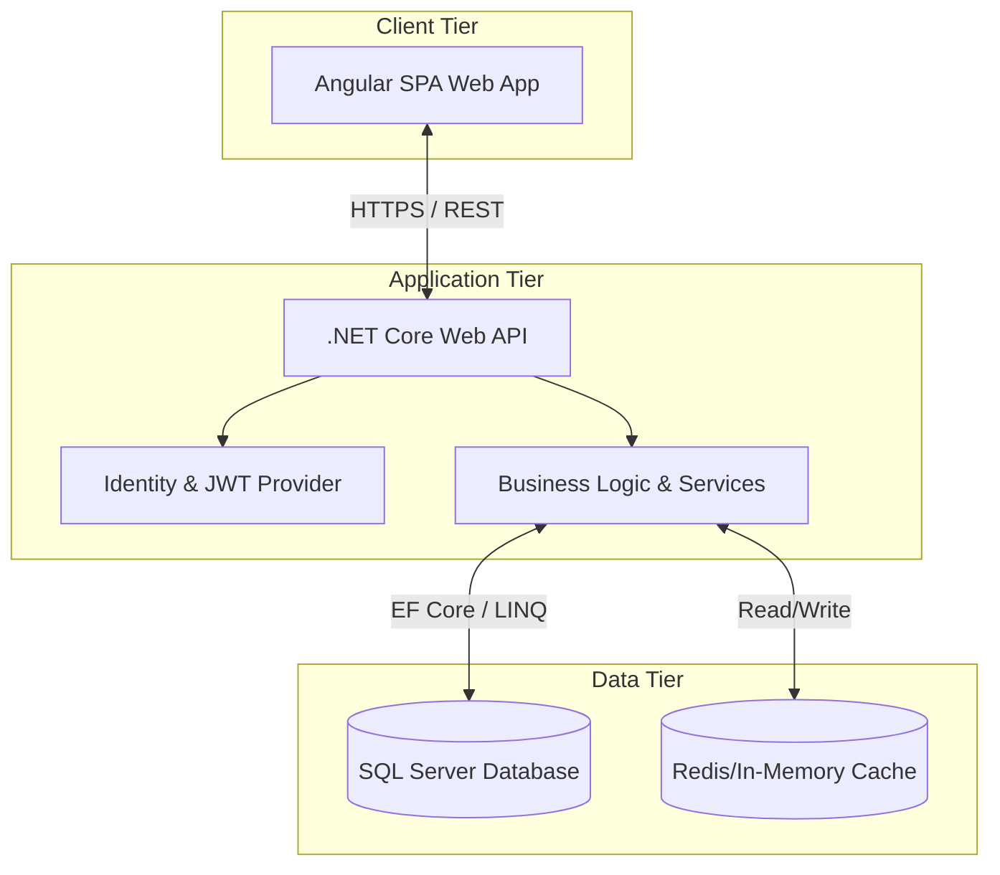
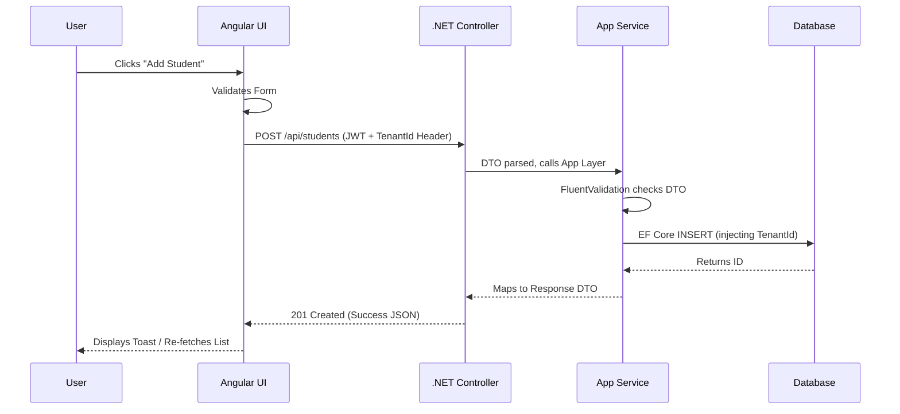

# 📘 Full System Architecture Document: School Management System

## 🧱 1. Project Overview

**Purpose of the System**
The School Management System is a comprehensive, multi-tenant enterprise application designed to streamline and automate the administrative, academic, financial, and communicative operations of educational institutions. 

**Target Users**
*   **System Administrators:** Global management, tenant creation, and cross-school analytics.
*   **School Administrators:** School-level configuration, user management, and master data setup.
*   **Teachers/Academics:** Grade management, attendance, curriculum planning, and student evaluations.
*   **Staff (Finance/Transport/HR):** Fee collection, payroll processing, transport management, and inventory control.
*   **Students/Parents:** Access to academic records, fee dues, announcements, and communication hubs.

**Key Modules**
*   **Core Management:** Student directory, admissions, and analytics.
*   **Academic Hub:** Curriculum planning, class scheduling, assessments, and grade management.
*   **Communication Hub:** Messaging, announcements, event management, and broadcast system.
*   **Finance & Operations:** Fee management, payment processing, budget planning, and expenses.
*   **Resources & Facilities:** Transport, hostel, digital library, and inventory.
*   **System Administration:** User management, RBAC (Role-Based Access Control), and multi-tenant configurations.

---

## 🏗️ 2. High-Level Architecture

The system utilizes a **Modern 3-Tier Architecture** integrated with **Clean Architecture principles** on the backend to ensure scalability, maintainability, and clear separation of concerns.

### Architecture Layers
1.  **Presentation Layer (Frontend):** Angular (Standalone Components, Material UI) handling the user interface, client-side routing, and state.
2.  **Application / API Layer (Backend):** .NET Core Web API serving as the central gateway, handling HTTP requests, authentication, and routing requests to the business logic.
3.  **Data Layer (Database):** SQL Server managing persistent, relational data with enforced tenant-level isolation.

---

## 🖥️ 3. Frontend Architecture (Angular)

The frontend is built using **Angular** with a modernized standalone component architecture and Angular Material for UI components.

**Structure & Folder Design**
*   `/core`: Singleton services (Auth, Tenant, Interceptors), guards, and globally shared interfaces.
*   `/shared`: Reusable UI components (TopSubnav, Sidebar), pipes, and directives.
*   `/layout`: Main layout wrappers (`main-layout.component`) determining structural scaffolding.
*   `/features` or `/app`: Domain-specific modules (e.g., `students/`, `academic/`, `communication/`, `finance/`).

**Key Concepts**
*   **Routing & Lazy Loading:** Components are highly modular and lazily loaded (e.g., `/app/students` loads only when accessed).
*   **State Management:** State is managed locally within services via `RxJS BehaviorSubjects` (e.g., `SidebarService`, `SubnavService`, `AuthService`, `TenantService`).
*   **Dynamic UI & Navigation:** Navigation items and badges react dynamically based on real-time changes and user roles. 

**Security & Interceptors**
*   **Authentication (JWT):** The `AuthService` handles authentication logic, while HTTP Interceptors append bearer tokens to outgoing API requests.
*   **Permission Guards:** Angular `CanActivate` guards protect routes based on the current user's role and feature permissions.

---

## 🧱 4. Backend Architecture (.NET Core)

The backend implements **Clean Architecture**, promoting the Separation of Concerns and Dependency Inversion.

**Structure & Pattern**
*   **Core / Domain Layer:** Contains core entities, interfaces, value objects, and business rules (e.g., `Student`, `Fee`, `Tenant`).
*   **Application Layer:** Contains business logic (Use Cases), CQRS (if MediatR is used), DTOs, Mapping profiles, and FluentValidation rules.
*   **Infrastructure Layer:** Implements data access (Entity Framework Core), repositories, identity management, external APIs (e.g., Email services).
*   **Presentation / API Layer:** Web API Controllers that handle HTTP requests and responses, injecting Application layer interfaces.

**Key Features**
*   **Validation:** Input validation handled entirely by `FluentValidation` piped through the application layer.
*   **Middleware Pipeline:** Global Exception Handler, Logging (Serilog/NLog), Tenant Context Resolver.
*   **Generic Repositories:** Repository pattern abstracting EF Core contexts.

---

## 🗄️ 5. Database Architecture (SQL Server)

The database schema is highly relational, enforcing referential integrity and tracking state globally via foreign keys.

**Core Tables & Domains**
*   `Tenants` (Global table storing school profiles, subscription status, and tenant codes).
*   `Users`, `Roles`, `UserRoles`, `Permissions` (Security and Identity tables).
*   `Students`, `Staff`, `Classes`, `Subjects` (Core Academic/Management Tables).
*   `Fees`, `Payments`, `Invoices` (Financial tracking).

**Multi-Tenant Implementation**
*   **Strategy used:** Single Database, Shared Schema.
*   **Isolation Method:** A mandatory `TenantId` column exists on nearly all operational tables (`Students`, `Fees`, `Staff`, etc.).

---

## 🔐 6. Roles & Permissions System

The system enforces granular **Role-Based Access Control (RBAC)** integrated closely with the multi-tenant architecture.

**How it Works:**
*   **Storage:** The database links `Users` to `Roles` (e.g., Administrator, Teacher, Student). Roles map to specific `Permissions` (e.g., `Students.Create`, `Fees.View`).
*   **Backend Validation:** .NET API Endpoints are protected via custom `[Authorize(Policy = "Permissions")]` attributes or manual claim checks inside service logic.
*   **Frontend Rendering:** The Angular app checks the active user's permissions array in their JWT token. Elements (like the Add Student button or Administration menu) are conditionally rendered using custom structural directives (e.g., `*appHasPermission="'Students.Add'"`).

---

## 🏢 7. Multi-Tenant Architecture

This architecture supports hundreds of schools using the same codebase and infrastructure, seamlessly separated.

**Data Isolation Strategy**
*   **Tenant Selection:** Handled dynamically via the `TenantService` in the frontend (`selectedTenantId`), often parsed from user profiles.
*   **Context Flow:** The frontend passes the `TenantId` either via a sub-domain, route parameter, or an `X-Tenant-Id` HTTP header via Interceptors.
*   **Backend Enforcement:** The `.NET Core API` pipeline utilizes a custom Middleware (`TenantResolverMiddleware`) to read the header and inject the `ITenantProvider` scoped service.
*   **EF Core Global Query Filters:** To prevent data leaks, EF Core intercepts all queries and automatically appends `WHERE TenantId = @currentTenant` to entities using global query filters.

---

## 🔗 8. API & Data Flow

**Standard End-to-End Flow (UI → API → Database → UI)**

---

## 🧭 9. Dynamic Menu & Navigation

The frontend navigation structure is engineered to be context-aware and role-responsive.

*   **Sidebar/Subnav Architecture:** A central `main-layout.component` controls the global UI framework (`SidebarComponent`, `TopSubnavComponent`).
*   **State-driven Rendering:** Using `SidebarService` and `SubnavService`, the UI knows exactly what screen size the user is on (via `BreakpointObserver`) and toggles sidebars (`MatSidenav`) automatically.
*   **Dynamic Badges:** Communication modules (Messages, Notifications) display real-time counters mapped to state variables.
*   **Search & Filter:** The menu contains an integrated real-time filtering mechanism based on search strings.

---

## ⚡ 10. Performance & Optimization

*   **Frontend (Angular):**
    *   `ChangeDetectionStrategy.OnPush` utilized where applicable.
    *   Strict lazy loading of feature modules.
*   **Backend (.NET Core):**
    *   Asynchronous controllers and services (`async`/`await`).
    *   EF Core queries optimized using `AsNoTracking()` for read-only operations.

---

## 🧪 11. Error Handling & Validation

**Standard API Response Wrapper**
All API endpoints return a standardized JSON structure ensuring the frontend can reliably map results or parse errors.

*   **FluentValidation:** Used in the Application Layer. If validation fails, an Exception is thrown and caught by Middleware, automatically formatting the `errors` array.
*   **Global Exception Handling:** A centralized middleware catches HTTP errors and 500s, preventing raw stack traces from reaching the client while logging to Serilog.